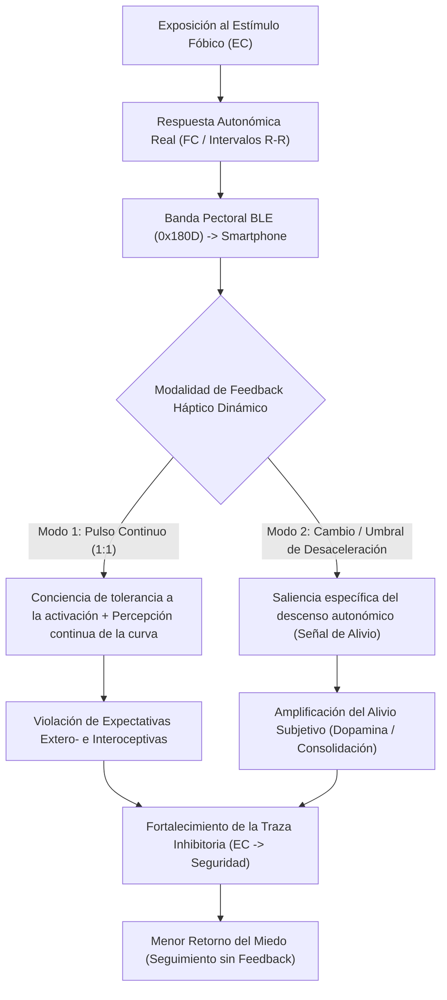

# Programa de Investigación Traslacional: Modulación Interoceptiva Háptica durante la Exposición en Miedos Específicos

## 1. Fundamentación Teórica y Modelo Mecanístico

En el tratamiento de los trastornos de ansiedad y miedos específicos mediante exposición, el modelo de **Aprendizaje Inhibitorio** (Craske et al., 2014, 2022) postula que la eficacia de la extinción depende de maximizar el **error de predicción** (la discrepancia entre la expectativa de una consecuencia aversiva y su no ocurrencia), más que de la simple habituación fisiológica intra-sesión.

Sin embargo, en individuos con alta **sensibilidad a la ansiedad** o predominio de procesamiento **bottom-up**, las señales interoceptivas (especialmente la taquicardia y la cardioaceleración frente al estímulo fóbico) operan bajo dos sesgos que obstaculizan la extinción:
1. **Hiperprecisión del prior interoceptivo de amenaza (Codificación Predictiva Interoceptiva; Seth, 2013; Paulus & Stein, 2010):** El sujeto sobreestima su activación autonómica (*"mi corazón se va a descontrolar"*) y utiliza la sensación visceral como evidencia de peligro inminente (*razonamiento emocional / ex-consequentia*: *"si siento taquicardia, entonces estoy en peligro"*).
2. **Ceguera a la recuperación autonómica (Déficit en la señal de alivio):** Incluso cuando la frecuencia cardíaca (FC) comienza a descender o estabilizarse en presencia del estímulo condicionado (EC), el paciente mantiene una representación subjetiva de alarma elevada, atenuando el **error de predicción de recompensa por alivio** (*relief learning*; Kalisch et al., 2019; Vervliet et al., 2017) necesario para consolidar la memoria de seguridad ($\text{EC} \rightarrow \text{No-EI}$).

## 1.5. Estado del Arte y Garantía de Originalidad (Qué se ha hecho vs. Qué es Inédito)

Para garantizar que esta serie experimental sea **estrictamente inédita y publicable en revistas de alto impacto** (*Behaviour Research and Therapy*, *Psychophysiology*, *Biological Psychology*), es fundamental diferenciar nuestro diseño de tres líneas previas que ya existen en la literatura:

| Lo que YA se ha hecho en la literatura (Antecedentes) | Limitación / Por qué NO responde tu pregunta | Lo que es **100% INÉDITO** en nuestra serie experimental |
| :--- | :--- | :--- |
| **1. Feedback cardíaco visual/auditivo en exposición (Valins, 1966; Telch et al., 2000; Shahar & Telch, 2003):** Mostrar en pantalla o por altavoz la FC durante exposición a claustrofobia o arañas. | Se diseñó bajo la antigua teoría de *habituación* (Foa & Kozak). Además, el feedback visual/auditivo compite por la **atención exteroceptiva** (distrae de mirar al estímulo fóbico). | **Canal háptico en lazo cerrado (*closed-loop*) sin distracción visual**, evaluado bajo el paradigma moderno de **aprendizaje inhibitorio** (violación de expectativas vs. aprendizaje por alivio) y con test de retorno del miedo **sin dispositivo**. |
| **2. Vibración lenta fija como "tranquilizante" (*EmotionCheck*; Costa et al., 2016; Azevedo et al., 2017):** Vibrar la muñeca a 60 BPM constantes para bajar la ansiedad al hablar en público. | Es una **manipulación estática de regulación** (busca calmar al sujeto engañándolo con un pulso lento). En clínica de exposición, eso opera como una **señal de seguridad (*safety signal*)** que impide la extinción real. | **Feedback dinámico contingente a la primera derivada cardíaca ($\frac{d\text{FC}}{dt}$)** *sin instrucción de calmarse*: contrastar hacer saliente la **meseta de activación** vs. hacer saliente únicamente la **pendiente de desaceleración espontánea (alivio)**. |
| **3. Biofeedback de VFC (HRV Biofeedback) en ansiedad:** Entrenar al paciente a respirar lento para controlar su FC durante el estrés. | Enseña **control deliberado (*top-down*)** para reducir la activación, lo cual contraviene la regla de exposición basada en aprendizaje inhibitorio (no usar conductas de reducción de ansiedad). | **Biofeedback interoceptivo *observacional* (no regulatorio):** El participante **no** intenta controlar la vibración; la vibración actúa como un *amplificador de error de predicción* (interoceptivo y de alivio) mientras el sistema autónomo responde naturalmente. |

> [!TIP]
> **La contribución única de tu programa:** Nadie ha puesto a competir experimentalmente en un paradigma de exposición las dos fases de la curva autonómica mediante estimulación háptica en lazo cerrado: **(A) Saliencia del pico simpático** (para maximizar la violación de la expectativa *"si mi corazón se acelera frente al estímulo, perderé el control"*) frente a **(B) Saliencia exclusiva de la pendiente de desaceleración vagal ($\Delta\text{FC}/\Delta t < 0$)** (para amplificar la señal dopaminérgica de *alivio espontáneo* tras el pico), evaluando cuál de las dos consolida mejor la memoria de extinción cuando se retira el feedback 48 horas después.

---

## 2. Arquitectura de la Serie de 3 Experimentos (Muestra Subclínica)

> [!IMPORTANT]
> **Criterio clave de rigor traslacional:** En los tres experimentos, la prueba crítica de eficacia (**Test de Retención y Renovación**) se realiza **con la vibración apagada** (solo con la banda puesta para medir psicofisiología). Esto permite demostrar que el feedback háptico facilitó la consolidación del aprendizaje inhibitorio y **no** funcionó como una conducta de seguridad (*safety signal*) que proteja contra la extinción.

### Selección de la Muestra (Común a la serie)
* **Población:** Adultos jóvenes/universitarios o comunidad general con **miedo específico subclínico alto** (puntaje $\ge$ percentil 80 en cuestionarios específicos: *FSQ* para arañas, *AQ* para alturas, *MBI* para sangre/inyecciones o *LSAS/PRCS* para hablar en público), sin diagnóstico de cardiopatía ni uso de betabloqueadores.
* **Variables Moderadoras / Estratificación Basal:**
  1. **Sensibilidad a la Ansiedad (ASI-3):** Subescala de preocupaciones físicas (*Physical Concerns*).
  2. **Conciencia Interoceptiva Multidimensional (MAIA-2):** Subescalas *Noticing*, *Not-Worrying* y *Trusting*.
  3. **Precisión Interoceptiva Basal (*Heartbeat Counting Task* - Schandry):** Medida objetiva antes de la exposición comparando latidos contados vs. latidos reales registrados por la banda BLE.
  4. **Error de Predicción Interoceptivo Basal:** $\Delta \text{FC}_{\text{percibida}} = \text{FC}_{\text{estimada por el sujeto}} - \text{FC}_{\text{real}}$.

---

### Experimento 1: Disociación en Lazo Cerrado de las Ventanas de la Curva Autonómica (Saliencia del Pico vs. Saliencia de la Derivada de Alivio)

#### Por qué no se ha hecho antes
Los estudios previos daban feedback continuo durante toda la sesión. Nunca se ha utilizado un algoritmo en tiempo real que entregue el feedback **únicamente en ventanas específicas de la dinámica cardíaca** para poner a prueba frente a frente las dos hipótesis de la teoría traslacional moderna: ¿se consolida mejor la extinción cuando el sujeto siente su **pico de taquicardia** sin que ocurra la catástrofe (*violación de expectativa interoceptiva*) o cuando se le hace táctilmente saliente el **inicio de su desaceleración vagal** (*aprendizaje por alivio*)?

#### Diseño Experimental ($5 \times 3$ Mixto)
* **Factor Entre-Sujetos (Ventana de Acoplamiento Háptico):**
  1. **Condición Pico (*Arousal-Locked* - `THRESHOLD_ALERT_ONLY`):** El teléfono vibra al ritmo del corazón **solo mientras la FC supera $+\Delta 15\%$ de la línea base** y se silencia en cuanto empieza a bajar. Aísla la exposición a la señal interoceptiva de alarma.
  2. **Condición Alivio (*Relief-Derivative-Locked* - `RELIEF_ONLY`):** El teléfono permanece en silencio durante el ascenso y el pico inicial, y **solo se activa cuando la primera derivada es negativa ($\frac{d\text{FC}}{dt} \le -2.5\text{ BPM}/10\text{s}$)** tras un episodio de activación. Aísla la señalización del alivio autonómico espontáneo.
  3. **Condición Bifásica / Continua (`CONTINUOUS` / `THRESHOLD_BOTH`):** El participante recibe tanto la fase de activación como la señalización del descenso.
  4. **Control Activo *Sham / Yoked* (`SHAM`):** Vibración tónica desacoplada de la derivada real del sujeto.
  5. **Control Exposición Estándar (`NONE`):** Banda puesta registrando FC/RR, sin vibración.
* **Factor Intra-Sujeto:** Pre-exposición (T0), Bloques 1–5 de Exposición (T1) y Test de Retención sin feedback a las 48 h (T2).

---

### Experimento 2: Manipulación de la Ganancia de la Pendiente de Recuperación (*Slope-Gain Perturbation*) tras un Pico Verídico

#### Por qué no se ha hecho antes
Los estudios clásicos de falso feedback (Valins, 1966; Telch et al., 2000; Azevedo et al., 2017) presentaban frecuencias falsas estáticas desde el inicio, lo que sufría de un grave problema metodológico: **baja credibilidad interoceptiva** cuando el sujeto sentía su corazón latir fuerte pero el aparato mostraba calma (o viceversa).
Nuestro Experimento 2 introduce un paradigma inédito de **Perturbación de la Derivada de Recuperación ($\gamma$)**:
* En los primeros segundos de contacto con el estímulo fóbico, **todos los grupos sienten su pico cardíaco 100% real** (garantizando anclaje interoceptivo y credibilidad total).
* Exactamente cuando el algoritmo detecta que la FC real empieza a estabilizarse o descender, manipula la **ganancia de la pendiente de bajada ($\gamma$)**:

$$\text{FC}_{\text{háptica}}(t) = \text{FC}_{\text{pico}} - \gamma \cdot \left(\text{FC}_{\text{pico}} - \text{FC}_{\text{real}}(t)\right)$$

1. **Meseta Prolongada / Extinción Profundizada Interoceptiva ($\gamma = 0.35$):** Aunque la FC real ya está bajando, el feedback háptico desacelera muy lentamente, manteniendo al sujeto expuesto a la percepción de taquicardia alta mientras comprueba que el estímulo fóbico sigue siendo inofensivo (*Deepened Interoceptive Expectancy Violation*).
2. **Alivio Acelerado ($\gamma = 1.75$):** En cuanto la FC real empieza a ceder ligeramente, el feedback amplifica la pendiente de caída hacia la línea base, maximizando el contraste de alivio temprano (*Enhanced Relief Prediction Error*).
3. **Trayectoria Verídica ($\gamma = 1.00$):** El descenso háptico refleja exactamente la pendiente real.

---

### Experimento 3: Desvanecimiento Háptico Adaptativo (*Adaptive Haptic Fading*) para Eliminar el Efecto de "Señal de Seguridad" y la Renovación Contextual (ABA)

#### Por qué no se ha hecho antes
El mayor obstáculo traslacional de cualquier biofeedback o ayuda tecnológica durante la exposición es que el paciente aprenda una regla condicional dependiente del contexto: *"Estoy a salvo frente a la araña/altura **porque** siento el dispositivo conmigo"*, provocando **renovación del miedo** al retirar el dispositivo. Nadie ha probado el **desvanecimiento paramétrico de la intensidad/densidad háptica (*Adaptive Fading*)** a lo largo de los bloques de exposición para transferir el control estimular desde la señal exteroceptiva-táctil hacia la interocepción endógena del propio sujeto.

#### Diseño Experimental ($3 \times 2$)
1. **Grupo Retiro Abrupto:** Feedback háptico al $100\%$ durante los 5 bloques de exposición en Contexto A $\rightarrow$ Test al día siguiente en Contexto B ($0\%$ feedback).
2. **Grupo Desvanecimiento Adaptativo (*Adaptive Fading*):** La duración/intensidad del pulso vibratorio se reduce progresivamente del Bloque 1 al Bloque 5 ($100\% \rightarrow 80\% \rightarrow 60\% \rightarrow 35\% \rightarrow 15\%$ de duración de pulso en ms) a medida que mejora la calibración interoceptiva del sujeto $\rightarrow$ Test en Contexto B ($0\%$ feedback).
3. **Grupo Exposición Estándar Sin Feedback.**
* **Hipótesis diferencial:** El grupo de *Retiro Abrupto* mostrará mejor desempeño intra-sesión pero sufrirá mayor renovación contextual en el Contexto B que el grupo de *Desvanecimiento Adaptativo*, el cual logrará internalizar la calibración interoceptiva ($\text{ICE} \to 0$) y mostrará la menor renovación del miedo en seguimiento.

---

## 3. Protocolo Operativo Paso a Paso de una Sesión Experimental (60 min)

| Minuto | Fase en la App | Actividad del Investigador y Participante | Variables Registradas |
| :--- | :--- | :--- | :--- |
| **00–10** | Preparación | Consentimiento informado, cuestionarios breales (ASI-3, MAIA-2) y colocación de la banda pectoral humedecida debajo del pectoral. | Datos demográficos y psicométricos. |
| **10–15** | `Línea Base` | Participante sentado en reposo (5 min). Seguidamente, tarea breve de conteo de latidos (Schandry: intervalos de 25, 35 y 45 s) sin tocarse el pulso. | $\text{FC}_{\text{basal}}$, $\text{RMSSD}_{\text{basal}}$, Índice de Precisión Interoceptiva ($I_{\text{acc}}$). |
| **15–20** | `Pre-Exposición` | Presentación visual a distancia del estímulo fóbico (BAT Pre). Registro de expectativas antes del contacto. Se coloca el teléfono en soporte de brazo/pecho o mano no dominante en **Modo Ciego**. | Pasos BAT Pre, Expectativa de peligro ($0–100$), SUDS ($0–100$), $\text{FC}_{\text{estimada}}$. |
| **20–45** | `Bloques Exposición 1 a 5` | 5 ensayos de $3\text{ min}$ de exposición con $1\text{ min}$ de pausa entre bloques. El software ejecuta la condición asignada (Continuo, Umbral/Cambio, Sham o Silencio). **Instrucción clave:** No buscar tranquilizarse; observar el estímulo y notar las sensaciones corporales sin evitarlas. | Serie temporal continua de FC/RR, SUDS, Expectativa de peligro, Alivio subjetivo ($0–100$) y $\text{FC}_{\text{estimada}}$ al final de cada bloque. |
| **45–50** | `Recuperación` | Reposo post-exposición (3 min) y evaluación de credibilidad/aceptabilidad del feedback háptico. | Pendiente de recuperación vagal ($\text{RMSSD}_{\text{post}}$). |
| **Sesión 2 (+48h)** | `Test Retención (Sin Feedback)` | BAT Post y 2 bloques de exposición ante estímulo original y estímulo generalizado **con motor háptico apagado**. | Retorno del miedo ($\text{SUDS}_{\text{T2}} - \text{SUDS}_{\text{Bloque 5}}$), Expectativa final y pasos BAT Post. |

---

## 4. Plan de Análisis de Datos (Psicofisiología y Modelos Mixtos)

1. **Índices Psicofisiológicos Derivados (calculados automáticamente por la Web App):**
   * **Reactividad Cardíaca ($\Delta\text{FC}$):** $\text{FC}_{\text{bloque}} - \text{FC}_{\text{línea base}}$.
   * **Tono Vagal Instantáneo (RMSSD):** Raíz cuadrada de la media de las diferencias al cuadrado de intervalos R-R sucesivos en ventanas móviles de $30\text{ s}$.
   * **Pendiente de Recuperación Intra-Bloque ($\beta_{\text{rec}}$):** Pendiente de regresión lineal de la FC desde el segundo de máxima activación del bloque hasta el final del bloque.
   * **Error de Calibración Interoceptiva ($\text{ICE}$):** $\text{BPM}_{\text{reportado por el sujeto}} - \text{BPM}_{\text{real en ese instante}}$.
2. **Modelos Estadísticos (en R `lme4` / JASP / Jamovi):**
   * Modelos Lineales Mixtos (LMM): $\text{Expectativa}_{ij} \sim \text{Condición}_i \times \text{Bloque}_j + \text{ASI3}_i + (1 + \text{Bloque}_j \mid \text{Sujeto}_i)$.
   * Análisis de Mediación Moderada: Evaluar si el efecto de la Condición sobre el Retorno del Miedo en T2 está mediado por: (a) la magnitud de la violación de expectativa ($\text{Expectativa}_{\text{Pre}} - \text{Expectativa}_{\text{Post}}$) y (b) el nivel de Alivio Subjetivo promedio.
